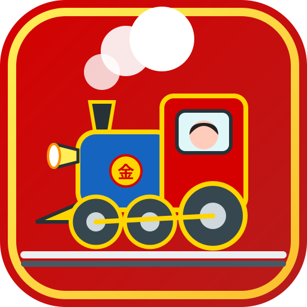

# 🚂 きんたろうてつどう（金太郎電鉄）〜全国わくわくアトラクション＆名産品めぐり〜

全国47都道府県のテーマパーク、牧場、水族館、おいしい名産品を買い集め、日本一の社長を目指すすごろくボードゲームです！
スマートフォン（iPhone / Android）およびPCのすべての画面サイズに最適化されています。



---

## 📱 スマートフォンでの快適プレイ機能（モバイル最適化）

- **スマホ専用レスポンシブUI**:
  - **上部スリムヘッダー**: 日付・目的地・距離が1行にスッキリ収まり、速度・ルビ・音切り替えは押しやすいコンパクトアイコンボタン化。
  - **横スワイプ式 社長ステータスリボン**: 4人の社長の情報（所持金・現在地・貧乏神）が画面の視界を塞がず、指で左右にスワイプ可能。手番の社長が自動でハイライトされます。
  - **親指で押しやすい下部コマンドドック**: 「🎲 さいころ」「🃏 カード」「🗾 全国図鑑」「📊 会社情報」が親指の届く位置に均等配置。
  - **見やすい分岐選択＆1マス戻るガイド**: 分岐駅での方向選択ボタンや「↩️ 1マスもどる」「🌟 最短おまかせ」もスマホで押しやすいワイドサイズ。
- **直感的なタッチ・ピンチズーム操作**:
  - **1本指ドラッグ**: 日本列島マップを自在にスクロール移動。
  - **2本指ピンチイン / ピンチアウト**: スマホの写真アプリのように直感的にマップを拡大・縮小。
  - **ダブルタップ**: 気になるエリアを素早く拡大。
  - **フローティング視点切り替えボタン**: 右サイドの「➕」「➖」「🗾 全国」「🚂 現在地」「🏁 目的地」ボタンでワンタップ移動。
- **セーフエリア＆PWA（ホーム画面追加）対応**:
  - iPhoneのダイナミックアイランド・ノッチ・下部ホームバーを考慮したセーフエリア（`safe-area-inset`）設計。
  - SafariやChromeの「ホーム画面に追加」を行うと、アドレスバーのない全画面ネイティブアプリ感覚で遊べます。
- **縦持ち・横持ち（Landscape）両対応**:
  - スマホを縦に持っても横に持っても、画面比率に合わせてレイアウトが自動調整されます。

---

## 🌐 GitHub Pages での公開手順（無料・数ステップで公開！）

このリポジトリを GitHub Pages で公開すると、スマートフォンやPCのブラウザからURLを開くだけですぐに遊べるようになります。

### 手順
1. **GitHubリポジトリの作成とプッシュ**:
   - 本プロジェクトの全ファイルを GitHub リポジトリ（例: `kintaro-tetsudo`）にプッシュします。
2. **GitHub Pages の設定**:
   - GitHub のリポジトリページを開き、上部タブの **「Settings」**（設定）をクリックします。
   - 左側メニューの **「Pages」** を選択します。
   - **「Build and deployment」** の **「Branch」** を以下のように設定します：
     - ブランチ: `main`（または `master`）
     - フォルダ: `/ (root)`
   - **「Save」** ボタンをクリックします。
3. **公開完了！**:
   - 数十秒〜1分ほどで、ページ上部に以下のような公開URLが表示されます：
     ```
     https://<あなたのGitHubユーザー名>.github.io/<リポジトリ名>/
     ```
   - このURLをスマートフォンのブラウザ（Safari / Chrome）で開くだけで、すぐにゲームがプレイできます！

### 📲 スマホのホーム画面に追加してアプリ化する方法
- **iPhone (Safari)**:
  1. 公開URLをSafariで開きます。
  2. 画面下部の中央にある **共有ボタン（四角から矢印が出ているアイコン）** をタップします。
  3. メニューから **「ホーム画面に追加」** を選び、右上の「追加」をタップします。
- **Android (Chrome)**:
  1. 公開URLをChromeで開きます。
  2. 画面右上の **メニューボタン（縦の3点リーダー）** をタップします。
  3. **「ホーム画面に追加」** または **「アプリをインストール」** をタップします。

---

## 🎮 ゲームのルールと特徴

- **1〜4人プレイ対応**: 家族や友達との対戦はもちろん、1人で3人のCPU（まめオニ・あかオニ・メカオニ）と対戦も可能！
- **全国47都道府県の直交マップ**: すべての線路が南北・東西に美しく整理され、迷わず直感的に進めます。
- **全国アトラクション＆名産品物件**: 各駅に実在する有名テーマパーク、牧場、ご当地グルメなどの物件が多数登場！独占すると収益が2倍に！
- **貧乏神（ボンビー）バトル**: 目的地から一番遠いプレイヤーに貧乏神が取り憑きます。他の列車に重なると擦り付けが可能！
- **多彩なカードシステム**: 急行カード、特急カード、スペシャルカード、ぶっとびカードなど逆転要素満載。
- **サウンドシンセサイザー搭載**: 外部音源ファイル不要のWeb Audio API音源で、サイコロ・汽車・ファンファーレなどの効果音とBGMが軽快に鳴り響きます。

---

## 📁 ファイル構成

```text
きんたろうてつどう/
├── index.html            # メインHTML（モバイル対応メタタグ・PWA対応）
├── manifest.json         # PWAマニフェストファイル
├── .nojekyll             # GitHub Pages用Jekyll除外ファイル
├── README.md             # プロジェクト説明書
├── css/
│   ├── style.css         # レスポンシブ＆モバイル最適化スタイルシート
│   └── animations.css    # サイコロ・列車・演出アニメーション
├── js/
│   ├── main.js           # ゲームメインループ・進行制御
│   ├── ruby.js           # フリガナ表示・トグル制御
│   ├── audio.js          # Web Audio API シンセサイザー音源
│   ├── ai.js             # CPU行動AIロジック
│   ├── data/
│   │   ├── stations.js   # 全国駅データ・物件リスト
│   │   ├── cards.js      # カードデータ・効果定義
│   │   └── events.js     # ランダムイベントデータ
│   └── ui/
│       ├── svgAssets.js  # キャラクター・列車・サイコロSVGアセット
│       ├── mapRenderer.js# 日本列島SVGマップ描画・ピンチズームエンジン
│       └── dialogs.js    # モーダルダイアログ・ルーレット・購入UI
└── icons/
    └── icon.svg          # アプリアイコン（金太郎列車）
```

---

## 🛠️ 開発者向け情報
本ゲームは純粋なHTML5 / CSS3 / Vanilla JavaScriptで構築されており、Node.jsやnpmなどのビルドステップなしでどの静的Webサーバーでも動作します。
